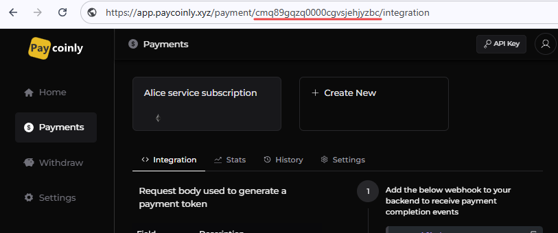

import Image from '@theme/IdealImage';

# Payment Token Generation

Your backend should call this endpoint in [Get a payment token](/docs/integrations/manual#get-a-payment-token) step, and the token will be used to display Paycoinly payment UI on your customers' side as described in [Manual Setup](/docs/integrations/manual#add-a-payment-ui-to-your-frontend) page.

### Endpoint

```
https://app.paycoinly.xyz/v1/pay/{payment-id}
```

It is a **POST** request.

To see `payment-id`, navigate to the corresponding payment in the **Paycoinly dashboard** > **Payments** - the ID will be visible in your browser's URL.



### Headers

```json
{ "x-api-key": "<api key>", "content-type": "application/json" }
```

The request should include `x-api-key` in its header.
Please check [this page](/docs/appendix/api-key) to get API key in your Paycoinly dashboard.

### Body

You can customize the request body to fit your specific business requirements, and you can see its syntax below.

```typescript
{
  price: string
  currency?: string
  localCurrency?: string
  metadata?: {}
}
```

You can see the meaning of each field in the below table.

| Field         | Mandatory | Default | Description                                                                                                                         |
| ------------- | --------- | ------- | ----------------------------------------------------------------------------------------------------------------------------------- |
| price         | Yes       |         | Service price - a numeric value representing the cost of the service                                                                |
| currency      |           | USD     | Currency in which `price` is specified. Refer to [currency list](/docs/appendix/currency-list) page.                                |
| localCurrency |           | USD     | `price` will be shown in local currency on user's side. Refer to [currency list](/docs/appendix/currency-list) page.                |
| metadata      |           |         | [Callback URL](/docs/integrations/manual#add-a-webhook-to-your-backend) will receive a request with this JSON value set in its body |


### Response

```json
{ "token": "<value>" }
```

Use this token to [show Paycoinly payment UI](/docs/integrations/manual#add-a-payment-ui-to-your-frontend) on your frontend code showing to your customers.

### Example

Below is an example of how to make a request to the endpoint using Node.js.

```javascript title="In your backend"
async function generatePaymentToken() {
  const response = await fetch('https://app.paycoinly.xyz/v1/pay/{payment-id}', {
    method: 'POST',
    headers: {
      'Content-Type': 'application/json',
      'x-api-key': '{x-api-key}'
    },
    body: JSON.stringify({
      price: 100.00,
      currency: 'USD',
      localCurrency: 'EUR',
      metadata: {
        orderId: 'abc123',
        customerId: 'user789'
      }
    })
  });

  if (!response.ok) {
    throw new Error(`HTTP error! Status: ${response.status}`);
  }

  const { token } = await response.json();

  return token;
}
```
