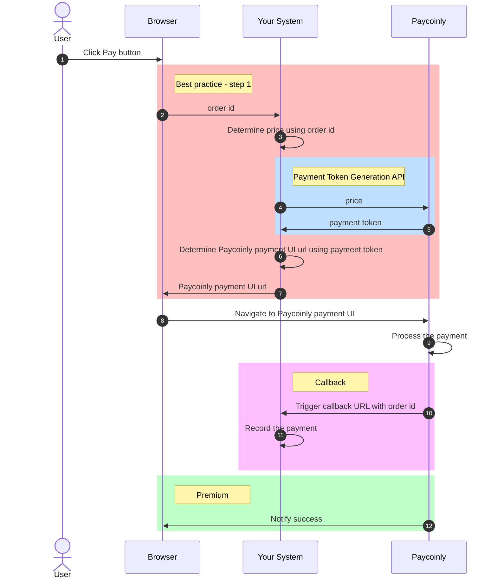

# How Does Payment Flow Work With Your System

The flow described on this page serves as the foundation for all payment integrations - [Manual Setup](/docs/integrations/manual), [Woocommerce](/docs/integrations/woocommerce) and [Wordpress](/docs/integrations/wordpress). Each integration is built upon the core workflow and logic outlined here.

Here are some elements showing in the diagram with links to detailed information.

- [Best practice - step 1](/docs/best-practices/manual#step-1)
- [Payment Token Generation API](/docs/api-reference/payment-token.mdx)
- [Callback](/docs/integrations/manual#add-a-webhook-to-your-backend)
- [Notify success](/docs/integrations/manual#receive-payment-success-event-in-your-frontend)

