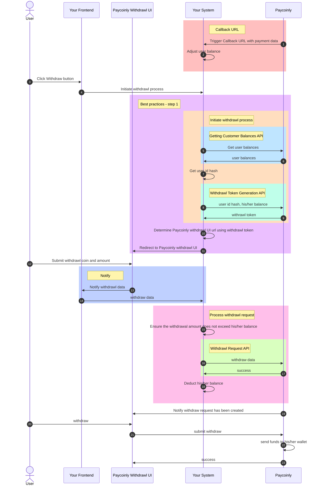

# How Does Withdrawl Flow Works With Your System

The flow diagram provides a clear overview of how the withdrawal process integrates with your system.

Here are some elements showing in the diagram with links to detailed information.
- [Callback URL](/docs/integrations/withdraw#add-a-webhook-to-your-backend)
- [Best practices - step 1](/docs/best-practices/withdraw#step-1)
- [Initiate withdrawl process](/docs/integrations/withdraw#initiate-withdrawl-process)
- [Getting Customer Balances API](/docs/api-reference/get-customer-balance)
- [Withdrawl Token Generation API](/docs/api-reference/withdraw-token)
- [Notify](/docs/integrations/withdraw#add-javascript-code)
- [Process withdrawl request](/docs/integrations/withdraw#add-a-backend-endpoint-to-process-withdrawl-request)
- [Withdrawl Request API](/docs/api-reference/withdraw-request)

