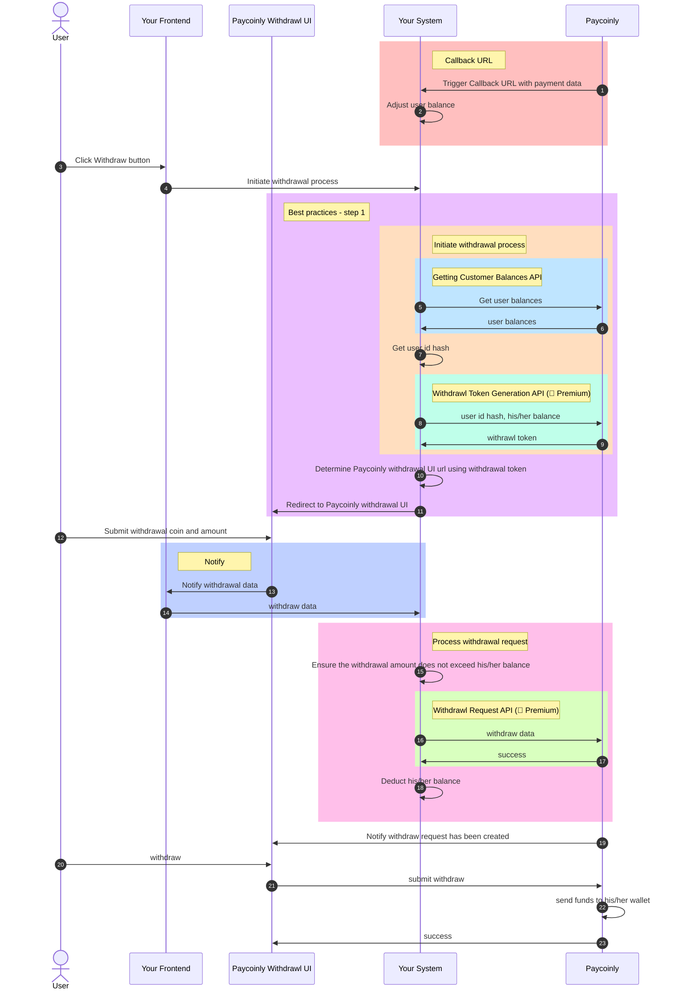

import Premium from '@site/src/components/premium'

# How Does Withdrawl Flow Work With Your System

The flow diagram provides a clear overview of how the withdrawal process integrates with your system and serves as the foundation for [Withdrawl Integration](/docs/integrations/withdraw) and [Withdrawl Integration Best Practices](/docs/best-practices/withdraw).

Here are some elements showing in the diagram with links to detailed information.
- [Callback URL](/docs/integrations/withdraw#add-a-webhook-to-your-backend)
- [Best practices - step 1](/docs/best-practices/withdraw#step-1)
- [Initiate withdrawal process](/docs/integrations/withdraw#initiate-withdrawal-process)
- [Getting Customer Balances API](/docs/api-reference/get-customer-balance)
- [Withdrawl Token Generation API](/docs/api-reference/withdraw-token) <Premium />
- [Notify](/docs/integrations/withdraw#add-javascript-code)
- [Process withdrawal request](/docs/integrations/withdraw#add-a-backend-endpoint-to-process-withdrawal-request)
- [Withdrawl Request API](/docs/api-reference/withdraw-request) <Premium />

