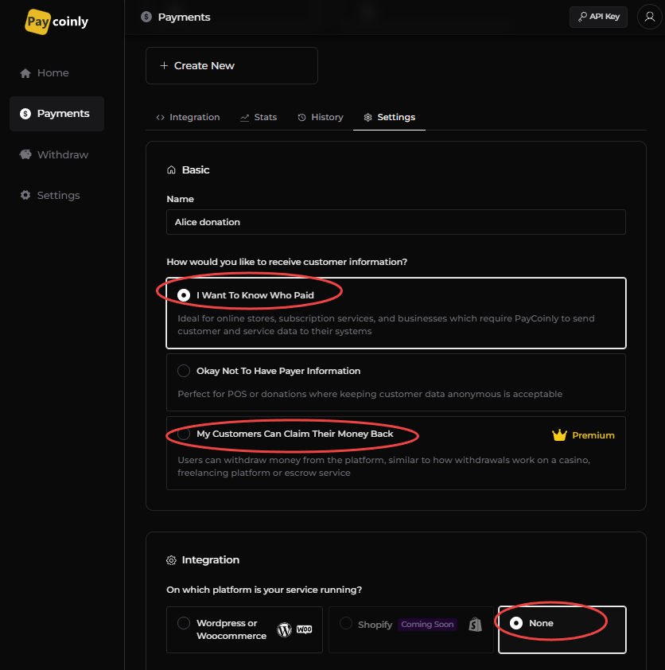
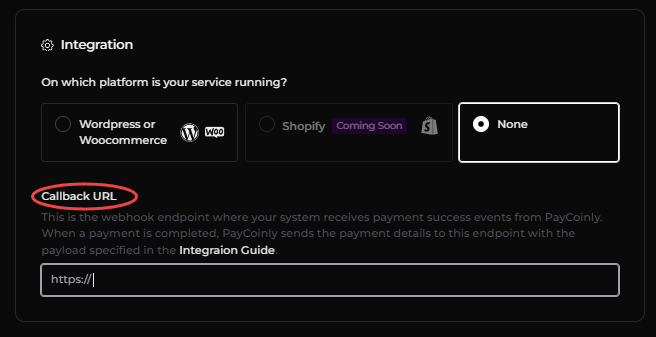

import Tabs from '@theme/Tabs';
import TabItem from '@theme/TabItem';
import Premium from '@site/src/components/premium'
import Image from '@theme/IdealImage';

# Manual Setup

Manual Integration enables developers to connect Paycoinly payment services to their platform using a custom-built integration approach, allowing your users to make payments through Paycoinly and have your platform record them.

### Prerequisites

Before you can start manual integration, ensure you have the following:

- **How would you like to receive customer information?** is set to one of the followings in **Payments** > **Settings** > **Basic**
  - **I Want To Know Who Paid**
  - **My Customers Can Claim Their Money Back**
- **On which platform is your service running?** is set to **None** in **Payments** > **Settings** > **Integration**



### Add a webhook to your backend

PayCoinly will call this endpoint when the payment is successfully completed.
Implement the necessary backend logic to record the payment in your system.

#### Endpoint

The webhook URL should be the one you set in **Settings** > **Integration** > **Callback URL** in your payment.



The webhook should be a **POST** route.

#### Header

The webhook will receive a request containing `x-api-key` header. Please check [this page](/docs/appendix/api-key) to get API key in your Paycoinly dashboard.

:::tip[Security Tip]
To secure this webhook and prevent unauthorized or arbitrary access
- Validate that the `x-api-key` header in the incoming request exactly matches with the above value.
- Only allow the route to be executed if this API key is correct. Otherwise, reject the request.
:::

#### Body

The endpoint expects the request body to contain the below fields.
- basic fields about the payment
- fields passed to [`metadata`](/docs/api-reference/payment-token#body) when generating a payment token in the [next step](#get-a-payment-token)

All fields are in string format.

| Field             | Description                                                                                                               |
| ----------------- | ------------------------------------------------------------------------------------------------------------------------- |
| chainId           | Chain ID of the payment coin                                                                                              |
| symbol            | Symbol of payment coin                                                                                                    |
| totalPaid         | Total amount of coin paid in gwei (or the smallest unit)                                                                  |
| netPaid           | Paid amount after transaction fee                                                                                         |
| claimable         | Amount to your users to claim if the payment is set to **My Customers Can Claim Their Money Back**, <br/> otherwise `"0"` |
| txLink            | A link to payment details                                                                                                 |
| `metadata` fields | [`metadata`](/docs/api-reference/payment-token#body) fields in destructured                                               |


### Get a payment token

In your backend, make a request to [Payment Token Generation API](/docs/api-reference/payment-token) to generate a payment token, which will be used in the next step.

### Add a payment UI to your frontend

Use the following URL to show Paycoinly payment page.

```
https://app.paycoinly.xyz/pay?token={token}
```

where `token` is the payment token obtained from [the above step](#get-a-payment-token).

Here is a sample HTML snippet that you can use to embed the payment UI.

<Tabs>
  <TabItem value="light" label="Light">
    <button style={{ padding: '.5em', backgroundColor: 'white', borderRadius: '.5em', border: '2px solid gray', marginBottom: '1em' }}>
      
    </button>
    ```HTML
    <button onclick="window.open('https://app.paycoinly.xyz/pay?token={token}', 'Pay with PayCoinly', 'width=800,height=550,left=200,top=100');">
      
    </button>
    ```
  </TabItem>
  <TabItem value="dark" label="Dark">
    <button style={{ padding: '.5em', backgroundColor: '#222', borderRadius: '.5em', border: '2px solid gray', marginBottom: '1em' }}>
      
    </button>
    ```HTML
    <button onclick="window.open('https://app.paycoinly.xyz/pay?token={token}', 'Pay with PayCoinly', 'width=800,height=550,left=200,top=100');">
      
    </button>
    ```
  </TabItem>
</Tabs>

### Receive payment success event in your frontend<Premium />

Add the following code to your frontend to receive payment success event.

```javascript
window.addEventListener('message', (event) => {
  if (event.origin !== 'https://app.paycoinly.xyz') {
    return;
  }
  if (event.data.type === 'PAYCOINLY_PAYMENT_COMPLETE') {
    // event.data.payload contains price, currency and metadata
    console.log(event.data.payload);
  }
});
```

Please see [Success Event](/docs/appendix/success-event) page to check how this event is triggered.

### Best practices

[This section](/docs/best-practices/manual) also describes best practices for implementing manual integration.