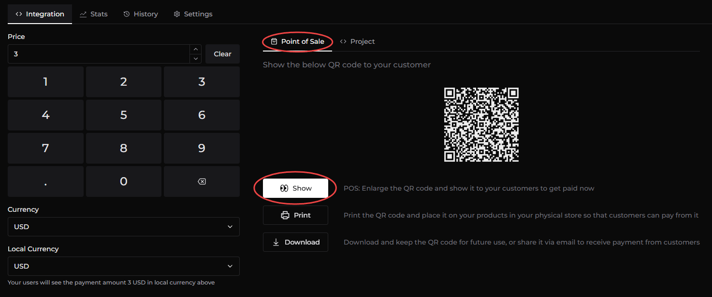

import Image from '@theme/IdealImage';

# How to use Paycoinly In Point-of-Sales and Local Businesses

Paycoinly is also a good choice to local businesses like local stores, barbers' shops, laundries, gyms, coffee shops and other physical retail locations looking to accept cryptocurrency payments.

### Configure POS option

Navigate to **Payments** > **Settings** > **Basic** and select **Okay Not To Have Payer Information**

### Enter price information

Navigate to **Payments** > **Integration** and enter **Price**, **Currency** and **Local Currency**.

### Show the QR code to your customer

Navigate to **Point of Sale** tab and click **Show** button to show the QR code to your customer to receive the payment.

