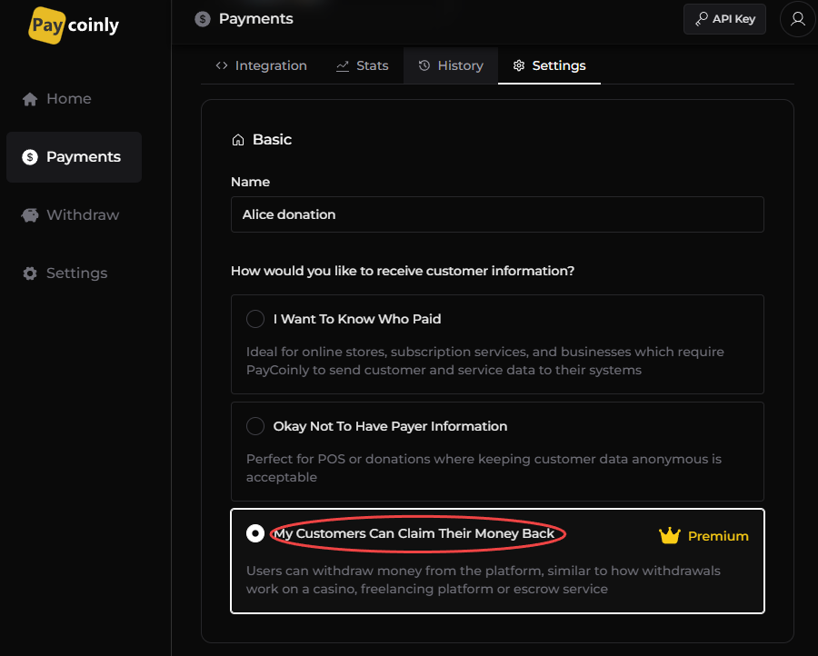

# Withdrawl Integration

Withdrawl Integration enables developers to connect Paycoinly withdraw service to their platform, allowing your users to seamlessly withdraw their balances from Paycoinly.

### Prerequisites

Before you can start withdrawl integration, ensure you have the following:

- **How would you like to receive customer information?** is set to **Okay Not To Have Payer Information** in **Payments** > **Settings** > **Basic**



### Process withdrawl request in your backend

As the first among all others, you need to add a **POST** endpoint to your backend which does the following things:

- handle the withdrawl logic

- ask Paycoinly to make a withdrawl request so that your customers can finalize their withdrawl action using it

The are detailed in [Implementation](#implementation) section.

#### Body

The endpoint expects the request body to contain the data specified below.

```typescript
{
  chainId: string
  symbol: string
  amount: string
  value: number
  currency: string
  wallet: string
  user: string
}
```

You can see the meaning of each field in the below table.


| Name     | Description                                                  |
| -------- | ------------------------------------------------------------ |
| chainId  | Chain ID of the token                                        |
| symbol   | Symbol of the token                                          |
| amount   | Token amount in wei (or smallest unit)                       |
| value    | Token amount value in currency                               |
| currency | Currency of value (Fixed to USD)                             |
| wallet   | Wallet address the user will withdraw to                     |
| user     | User id in your system for him/her performing the withdrawal |

#### Implementation

- Ensure the withdrawal amount (or value) in the payload does not exceed the user's balance in your system.

- After validation, deduct the specified amount from the user's balance in your system.

- Lastly, send a withdrawl request to [Making Withdrawl Request API](/docs/api-reference/withdraw-request).

### Initiate withdrawl process

When your user initiates a balance withdrawl, your backend needs to perform following tasks.

#### Check customer balances

Check balances of your customers by making request to [Getting Customer Balances API](/docs/api-reference/get-customer-balance) in your backend.
The API responds with a list of coins and their respective balances.

#### Get withdrawl token

Your backend must call the [Withdrawl Token Generation API](/docs/api-reference/withdraw-token) using your user ID initiating the withdrawal, along with the corresponding balance information stored in your system.
The API returns a withdrawal token, which can then be used to link and launch the Paycoinly withdrawal UI via the following URL.

```
https://app.paycoinly.xyz/claim/{token}
```

:::info
It is the responsibility of your system to maintain and track the withdrawal eligibility of each user.
Paycoinly does not store or manage individual user balances within your platform; it only maintains the aggregate balance of all your users combined.
Therefore, when generating a withdrawal token, your backend must provide the user's available balance to [Withdrawl Token Generation API](/docs/api-reference/withdraw-token#body).
:::

### Add a withdraw UI to your frontend

### Best practices

