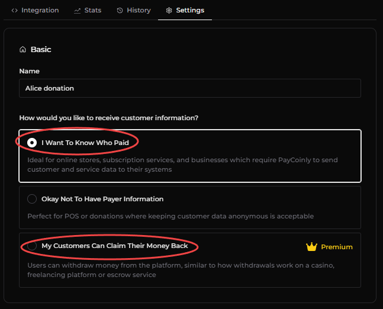
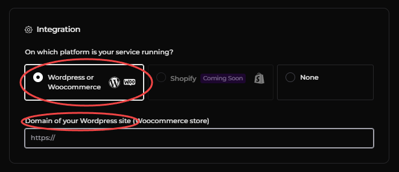
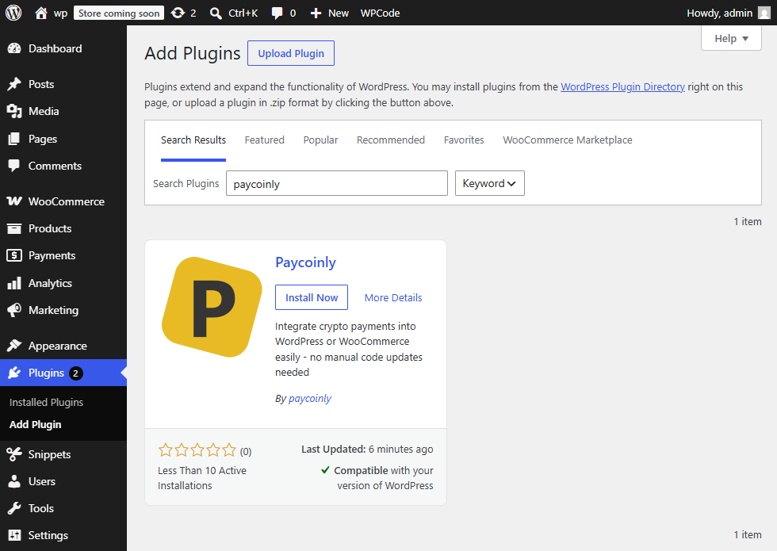
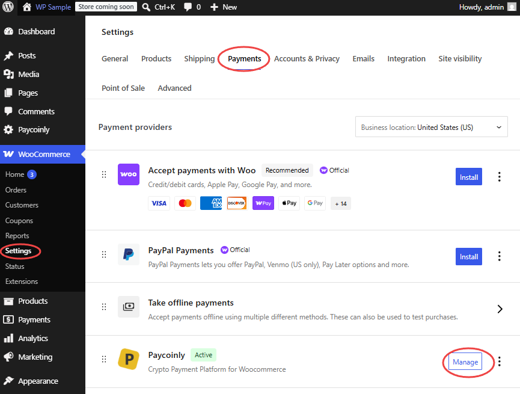

import Image from '@theme/IdealImage';

# Woocommerce Integration

This page explains how to seamlessly integrate Paycoinly with your Woocommerce store using the official [Paycoinly plugin](). With this approach, there's no need for manual setup, such as adding webhooks or embedding Paycoinly UI elements - everything is fully automated and handled directly through the plugin.

Payments triggered when your customers click **Place order** button on the checkout page are executed with the configurations you make here.

### Prerequisites

Before continue, ensure you have the following:

- **How would you like to receive customer information?** is set to either **I Want To Know Who Paid** or **My Customers Can Claim Their Money Back** in **Payments** > **Settings** > **Basic**

### Configure Woocommerce options

Navigate to **Payments** > **Settings** > **Integration**, select **WordPress or WooCommerce**, and enter the domain of your Woocommerce store.

### Install and configure Paycoinly plugin

- Install Paycoinly plugin in your Wordpress admin dashboard.

- Navigate to Paycoinly in Woocommerce Payments page.

- Check **Activate Paycoinly Gateway in Woocommerce** and provide **API Key**. Please check [this page](/docs/appendix/api-key) to get API key in your Paycoinly dashboard.

- Select a payment in **Payments** section. All customer payments from your store will be routed to it.

:::info
If you see some payments disabled, it's because they are not eligible for your store.
You can select a payment in Paycoinly plugin which satisfies [prerequisites](#prerequisites) and has the correct [Woocommerce options](#configure-woocommerce-options) configured.
:::

- Click **Save Changes** button.

### Plugin actions and filters

You can leverage actions and filters provided from the Paycoinly plugin to extend its functionalities on your own when your platform processes payments.
Please check [WP Plugin Hooks](/docs/appendix/wordpress-plugin-hooks) for more information.

