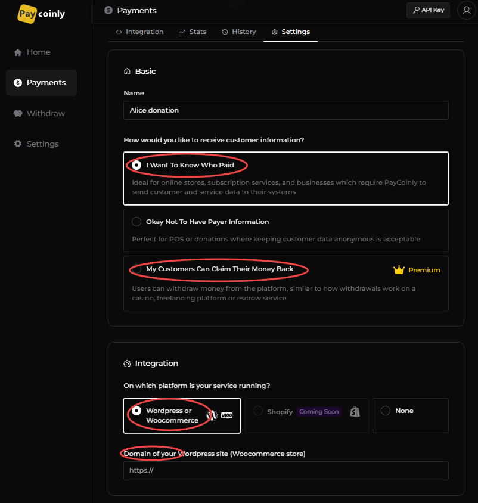
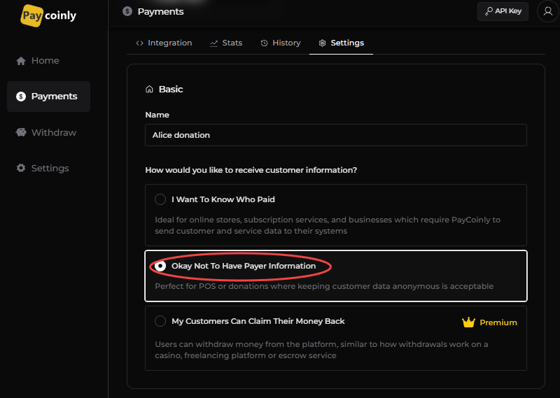
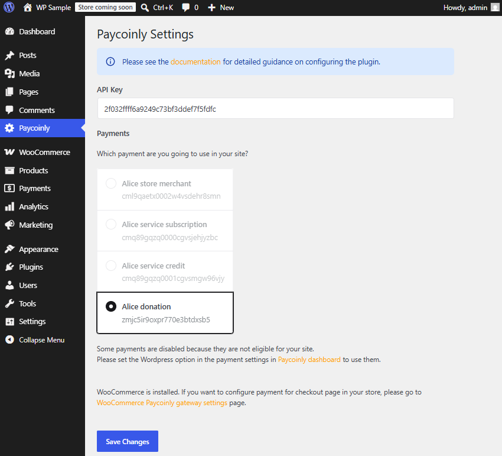

# Wordpress Integration

This page explains how to seamlessly integrate Paycoinly with your Wordpress site using the official [Paycoinly plugin](). With this approach, there's no need for manual setup, such as adding webhooks or embedding Paycoinly UI elements - everything is fully automated and handled directly through the plugin.

Payments triggered via `paycoinly` shortcode, which is described [in the below](#place-paycoinly-ui), on any other Wordpress page except the Woocommerce checkout page are executed with the configurations you make here.

### Configure Wordpress options

You can integrate Paycoinly into your WordPress site using one of the following two options:

- **Keep payer information**: Choose this option if you want to identify who made each payment and have your platform record customer payment details. For more information, see [Keeping payer information](#keeping-payer-information) section.

- **Anonymous payments**: Choose this option if you do not require customer details and only wish to accept payments, similar to a donation model. For more information, see [Anonymous payment](#anonymous-payment)t section.

#### Keeping payer information

- Please set **How would you like to receive customer information?** to either **I Want To Know Who Paid** or **My Customers Can Claim Their Money Back** in **Payments** > **Settings** > **Basic**.

- Navigate to **Payments** > **Settings** > **Integration**, select **WordPress or WooCommerce**, and enter the domain of your Wordpress site.

#### Anonymous payment

Please set **How would you like to receive customer information?** to **Okay Not To Have Payer Information** in **Payments** > **Settings** > **Basic**.

### Install and configure Paycoinly plugin

- Install Paycoinly plugin in your Wordpress admin dashboard.

- Navigate to Paycoinly in Wordpress admin dashboard.

- Enter **API Key**. Please check [this page](/docs/appendix/api-key) to get API key in your Paycoinly dashboard.

- Select a payment in **Payments** section. All customer payments from your site will be routed to it.

:::info
If you see some payments disabled, it's because they are not eligible for your site.
You can select a payment in Paycoinly plugin which has the correct [Wordpress options](#configure-wordpress-options) configured.
:::

- Click **Save Changes** button.

### Place Paycoinly UI

Please use [`paycoinly` shortcode](/docs/appendix/wordpress-plugin-hooks#shortcodes) to render UI element, enabling your users to navigate to Paycoinly payment UI.

### Plugin actions and filters

You can leverage actions and filters provided from the Paycoinly plugin to extend its functionalities on your own when your platform processes payments.
Please check [WP Plugin Hooks](/docs/appendix/wordpress-plugin-hooks) for more information.
